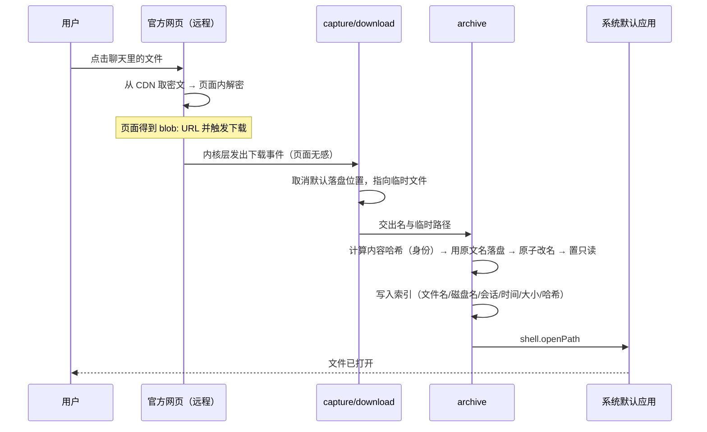
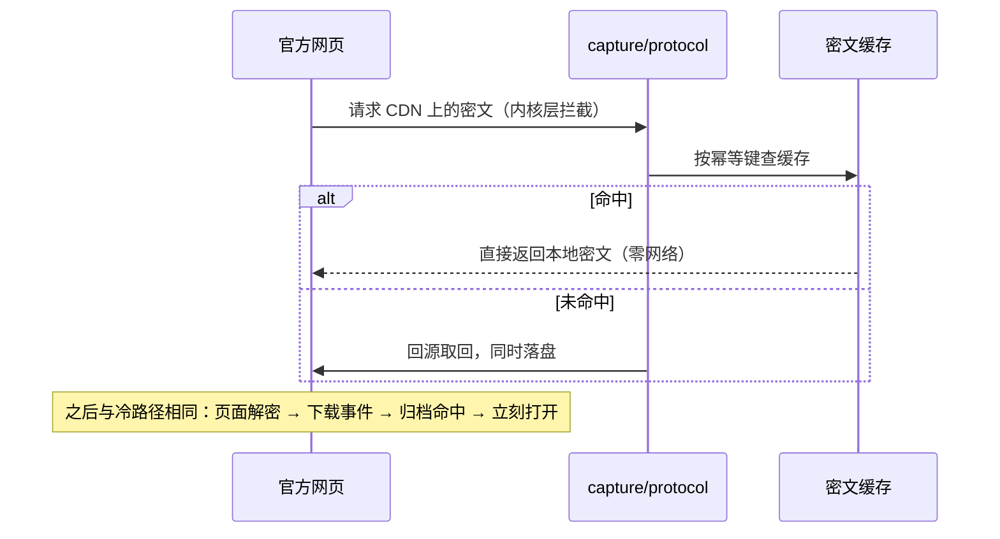

# 架构

本文档描述**分层、职责边界与数据流**。设计取舍的理由见 [`decisions.md`](decisions.md)；接管机制的实现细节见 [`media-capture.md`](media-capture.md)。

> ⚠️ **本文描述的是 [ADR-0043](decisions.md#adr-0043) 之前的架构**（Electron 承载网页版 + 内核层接管）。
> 迁移方向见 [ADR-0043](decisions.md#adr-0043) / [ADR-0044](decisions.md#adr-0044)：网页版改由
> `whatsapp-web.js` 自己启动的独立 Chromium 承载，本仓库的 Electron 进程降级为归档层与本地界面。
> 代码尚未迁移完，所以下面的分层与数据流**仍是当前代码的真实结构**；但"页面 JS 一行不改""页面永远只是
> 被观察的不可信对象"这类**承诺**已不再是产品边界 —— T1 类风险因此需要靠 preload 设计自己守住
> （见 [`security.md`](security.md) T1）。

---

## 1. 一句话架构

一个 Electron 进程，里面跑着**两个互不信任的世界**：

- **远程世界**：官方网页版。我们视其为不可信内容 —— 它会变、可能被投毒、绝不赋予任何本地能力。
- **本地世界**：主进程。它独占文件系统、数据库、系统集成能力。

两者之间只有一条**单向**的通道：页面产生的事件（下载、网络请求）被本地世界观察，本地世界把文件落盘、把文件交给系统打开。**页面永远不能主动要求本地做什么。**

```
┌─ 远程世界（不可信） ────────────────┐
│  web.whatsapp.com                  │  ← 迁移前：页面 JS 逐字节来自上游（见文首说明）
│  · 消息记录、媒体指针（IndexedDB）  │
│  · 解密在页面内完成                 │
└──────────────┬─────────────────────┘
               │ ① 下载事件 ② 媒体 https 请求
               │   （内核层可见，页面无感）
┌──────────────▼─────────────────────┐
│  本地世界：Electron 主进程           │
│                                    │
│  capture/   ── 观察并接管上述事件    │
│  archive/   ── 内容寻址存储 + 索引   │
│  integration/ ── 系统集成            │
│  ipc/       ── 只服务本地界面        │
└──────────────┬─────────────────────┘
               │ ③ shell.openPath
┌──────────────▼─────────────────────┐
│  系统默认应用（PDF 阅读器、LibreOffice…）│
└────────────────────────────────────┘
```

**这条单向性是整个架构的安全根基。** 任何"让页面能调用本地能力"的改动都是架构级错误，而不仅是代码问题。

## 2. 分层与职责

| 层 | 目录 | 职责 | 明确**不**做的事 |
|---|---|---|---|
| L0 宿主 | `src/main/index.ts`、`window.ts` | 生命周期、窗口、单实例、`app_id` 与桌面条目对齐 | 不处理业务逻辑 |
| L1 会话 | `src/main/session.ts` | 分区、持久化、UA、权限白名单、下载默认行为重写 | 不知道归档的存在 |
| L2 接管 | `src/main/capture/` | 观察内核层事件，产出「一份文件 + 它的身份」 | **不做解密**、不解析页面结构、**不改请求与响应体**；不决定"用户点了哪个文件"（那是上游的事，我们按 URL 与内核行为判定） |
| L3 归档 | `src/main/archive/` | 内容寻址存储、索引、去重、淘汰 | 不知道文件从哪来 |
| L4 集成 | `src/main/integration/` | 交系统打开、托盘、应用图标（含用户级启动器条目） | 不决定存哪里、不决定何时存、**不解码图片**（那是渲染进程的事，见 ADR-0022） |
| UI | `src/renderer/` | 「文件列表」与「设置」两扇窗口（各一个 HTML 入口，见 ADR-0025） | 不直接访问文件系统（走 IPC） |
| 桥 | `src/preload/index.ts` | 白名单 API | **不提供任何让远程页面调用的入口** |
| 调试 | `src/main/dev-probe*.ts` | **仅开发模式**：把只读探针注入承载页面的那扇窗口（[ADR-0046](decisions.md#adr-0046)） | 不参与任何业务路径、不改页面、不读密钥；打包产物里零注入 |

分层的判据是**依赖方向**：L2 可以调用 L3，L3 不知道 L2 存在。L3 的单元测试因此不需要任何 Electron 环境（见 `test/unit/`）。

## 3. 三条数据流

### 3.1 首次打开一个文件（冷路径）



关键点：**用户不需要看到"下载中"，也不需要决定存到哪里。** 临时文件先落地、算完哈希再原子改名，保证归档目录里不存在半成品。

> **PDF 不走这条路径。** 上游点开 PDF 时打开的是它自己的**预览页**
> （`*.whatsapp.net/pdf-viewer/`），PDF 由内核内置阅读器在里面渲染 —— 而那个阅读器在 Electron 里
> **关不掉**（实测见 [ADR-0029](decisions.md#adr-0029)）。曾经有一条"挡掉预览页、把 `application/pdf`
> 降级成下载"的路径，已由 [ADR-0051](decisions.md#adr-0051) **整体移除**（它挡得住内容、挡不住上游那个
> 面板，用户得到的是"一直转圈"）。
>
> 因此：**PDF 不进归档**，除非你自己点消息上的「下载」——那一步会走上面这条冷路径。
> 要它自动走到这里，得注入页面（[INV-1](decisions.md#adr-0002) 已由
> [ADR-0043](decisions.md#adr-0043) 撤销，但代码尚未迁移）。

### 3.2 再次打开同一个文件（热路径）



热路径要解决的是"**上游每次点击都会重新下载**"这件事。注意缓存的是**密文** —— 我们不参与解密，页面拿到密文自己解。

> 这一层可以关（设置里的"密文磁盘缓存"），而且**默认开启**：[ADR-0028](decisions.md#adr-0028)。
> 关闭后冷路径完全不受影响，代价只是"第二次打开仍要联网取一遍密文"。切换是一次**事务式转换**
> （切协议层 → 转换 → 提交，失败回退），没有确认框也没有进度屏，因此**不需要重启**：提交的
> 那一刻这一层就跟着注册或注销（[ADR-0027](decisions.md#adr-0027)）。启动时的对账保留着，但角色
> 变成崩溃恢复的兜底 —— 见 `capture/cache-files.ts` 与 `capture/cache-switch.ts`。

### 3.3 后台预取（可选增强）

收到文档类消息时，后台按同一幂等键把密文预先拉进缓存。用户点开时走的是热路径，连进度条都不会出现。

这与 3.2 共用同一套缓存与幂等键实现，**不引入第二套下载逻辑** —— 这是刻意的约束：任何第二条下载路径都意味着两套失效模式。

## 4. 幂等键：整个机制里最需要小心的设计

上游的媒体 URL 带有会过期的签名参数。缓存键必须**剔除易变部分、保留稳定的对象标识**。

| 部分 | 处理 | 原因 |
|---|---|---|
| host | 必须匹配，否则直通 | 只接管媒体 CDN |
| pathname | **参与**键计算 | 每个媒体对象一个稳定路径 |
| `oh=` / `oe=` 等签名 | 剔除 | 每次请求都会变，含进去缓存永不命中 |
| `_nc_hot` 等提示参数 | 剔除 | 与内容无关 |

风险与对策写在 [`media-capture.md`](media-capture.md#3-幂等键) —— 尤其是"剔除后是否仍能唯一标识对象"这个前提，它只能靠实测确认，不能靠推理。

## 5. 失效与降级

上游改版是**必然发生**的。架构上的要求是：**允许失效，但不允许静默失效。**

| 失效点 | 期望行为 |
|---|---|
| 下载事件不再触发 | 退回原生下载行为，同时**在日志与界面明确告知**"接管未生效"（界面那一半是系统通知，每种原因一次 —— 设置窗口的顶栏已在 [ADR-0042](decisions.md#adr-0042) 里去掉） |
| 缓存键算不出稳定值 | 跳过缓存，只做单次落盘（功能降级但不错乱） |
| 归档写盘失败（磁盘满、权限） | 退回原生下载，并保留可见的错误提示 |
| 打开失败（无关联应用） | 提示用户，给出归档中的绝对路径，允许手动处理 |

**静默降级是不可接受的**：用户会以为文件没下载成功，然后去 `~/Downloads` 翻，而这恰好是本项目要消灭的行为。`scripts/check-capture.ts` 的存在就是为了把"接管还活着吗"变成一个可以主动检查的问题。

## 6. 存储布局

```
~/Documents/WaaChat_files/             # 归档：位置可在设置里改（ADR-0018 / ADR-0023 / ADR-0032）
├── 18665597400/                 # 账号那一层（ADR-0039）：页面记下的 WID；拿不到 → `unknown-account`
│   └── 18665597400@c.us/        # 会话那一层（ADR-0055）：文件来自哪个聊天会话；拿不到 → `unknown-chat`
│       └── files/               # 明文正文（密文在**另一个根目录**里镜像同样的层级，见下）
│           ├── 采购合同.pdf      # 正文：原文名落盘、只读（ADR-0031）
│           │                    #   同一个会话内同名不同内容 → `采购合同 (a1b2c3d4).pdf`
│           └── 报价单.pdf        #   不同会话的同名文件互不干扰，各自用原名；
│                                #   同一份内容跨会话时是硬链接（多一个名字、不多占字节）
├── 18665597400/3EB0A1B2C3D4E5F6/files/  # ADR-0052 的第二级（消息ID）：不搬动，照旧可读、可迁移
├── 18665597400/files/2026-10/   # ADR-0037 / ADR-0039 的旧布局（账号 / 年-月）：同上
├── 旧文件.pdf                    # 更早的平面布局：同样不搬动，照旧可读
└── .index.sqlite                # 归档索引 + FTS5 虚表（一整个归档一棵，存内容哈希与**相对路径**）

~/.local/share/waachat/            # XDG_DATA_HOME
└── cache/<账号>/<年-月>/         # 密文缓存（默认开启；可安全删除，删了只是要重新下载）
                                 #   层级与归档镜像，但**根目录独立**（ADR-0008 / ADR-0039）

~/.config/waachat/                 # XDG_CONFIG_HOME（Electron 的 userData）
├── settings.json                # 用户偏好（不含凭据）
└── …                            # 会话分区 persist:waachat —— 登录凭据在这里

~/.cache/waachat/                  # XDG_CACHE_HOME
└── logs/                        # 日志（含脱敏约定，见 security.md）
```

三类数据的**生命周期不同**，因此**必须分开放**：

- 登录凭据（会话分区）丢了要重新扫码，**绝不可清除**，也绝不能被"清理缓存"类功能碰到。
- 归档是用户的资产，**只在用户明确要求时删除**；它的位置由用户决定，索引跟着它一起走（[ADR-0018](decisions.md#adr-0018)）。归档正文按「账号 × 会话ID」分层到 `<账号>/<会话ID>/files/`（[ADR-0055](decisions.md#adr-0055)），但**定位只依赖索引里的相对路径**，不靠时间反推 —— 旧记录（历史上是 `<账号>/<消息ID>/files/`、`<年>/<月>/`、`<账号>/files/<年-月>/` 或平面布局）因此不必搬迁；在「文件列表」里删掉某个会话的最后一份正文后，那一层空目录会被一并收掉（[ADR-0054](decisions.md#adr-0054)）。换位置因此是一次**完整迁移**而不是半截状态：先确认、再搬数据、最后落设置，任一步失败都回滚（[ADR-0019](decisions.md#adr-0019)）。索引的清单在**执行时**才解析 —— 计划是连接还开着的时候算的，而执行的第一步会关掉它并顺带删掉 `.index.sqlite-wal` / `-shm`（[ADR-0024](decisions.md#adr-0024)）。
- 密文缓存是纯派生数据，任何时候删掉都只影响性能。

把它们混在一个目录里，是这类应用最常见的自伤方式（一个"清空缓存"按钮把登录态也清了）。

## 7. 为什么不把归档做成"可浏览的聊天记录"

因为那需要解析消息、联系人与会话结构，而消息从**页面内的数据库**取出就必须动页面或动协议 —— 直接违反 [INV-1 / INV-2](../ai/INVARIANTS.md)。

因此归档层的**唯一输入**是"一份文件 + 它是被谁在什么时候打开的"这种级别的元信息。它足够支撑"我能找到我打开过的文件"，但不足以还原会话。这是刻意的边界，不是功能缺失。
